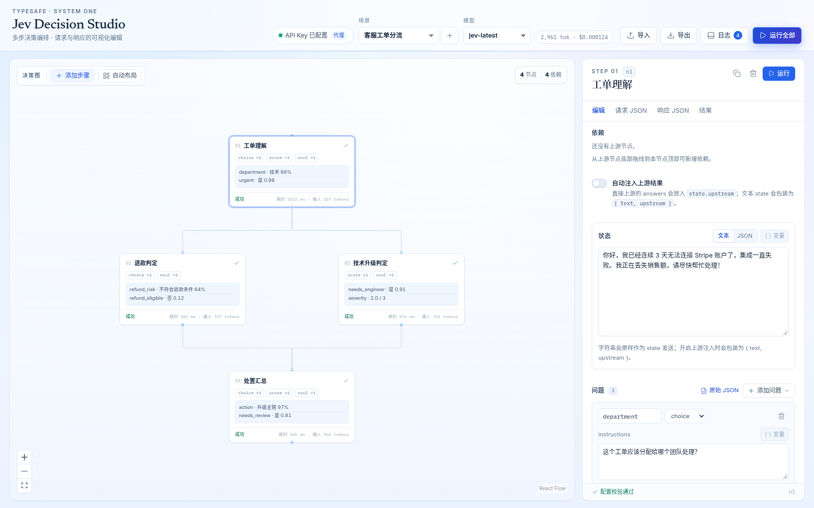
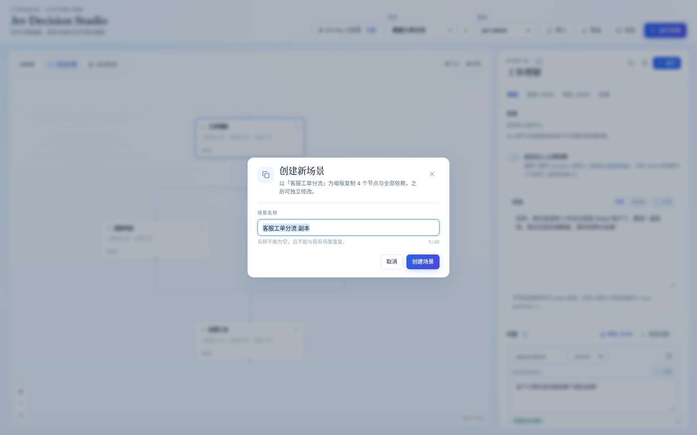
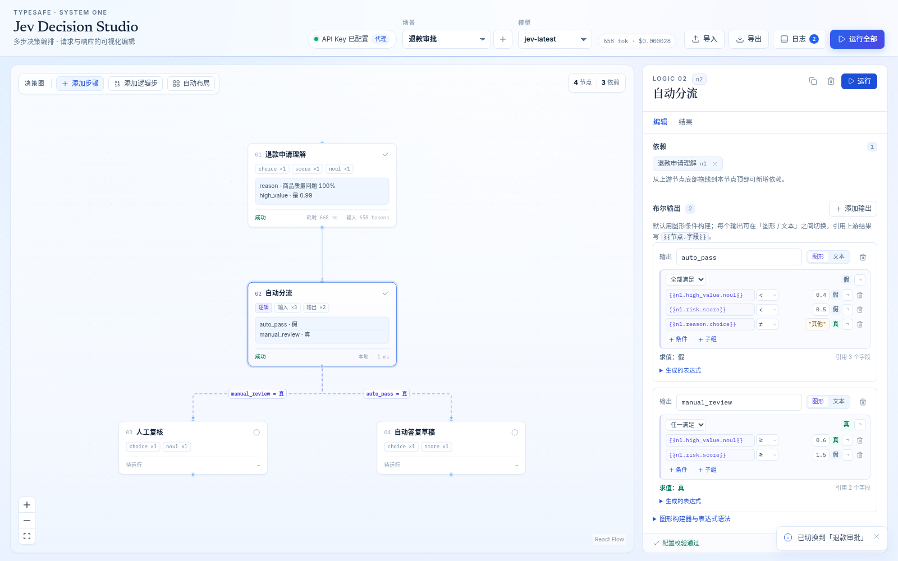

# Jev Decision Studio



本地运行的多步决策编排工作台。用节点图组织多次 Jev 调用，可视化编辑发送给模型的 `state` 与 `questions`，并展示返回的概率、置信度、原始 JSON、token 与费用。

- 官方 Jev 是 TypeSafe 的托管 API，本项目是**本地客户端 + 代理服务**，不是模型权重部署。
- 支持 `choice` / `score` / `noul` 三类文本问题；`box` 需要图片输入，首版不做。
- 自由 DAG：任意依赖边、环检测、拓扑执行；支持 `{{节点.问题.字段}}` 模板与上游结果自动注入。
- 逻辑步：不调用 Jev 的本地布尔计算卡片，默认用可视化条件组构建，用比较、算术与逻辑门决定下游连线是否放行。
- 浅色学术风、蓝白渐变、无 emoji。

## 快速开始

要求：Node.js 22+、pnpm、可访问 `api.typesafe.ai` 的本地代理。

```bash
pnpm install
pnpm dev
```

打开 <http://127.0.0.1:5173>。

`.env` 需要至少两个变量：

```dotenv
TYPESAFE_API_KEY=apikey_xxx
TYPESAFE_PROXY=http://127.0.0.1:7892
PORT=8791
```

`TYPESAFE_PROXY` 不能省：直连 `api.typesafe.ai` 会返回 **451**，必须经代理访问。API Key 只在本地 Node 服务中读取，浏览器永远拿不到。

## 使用方式

1. 顶部选择示例场景（客服工单 / 简历初筛 / 内容审核 / 退款审批），或从画布工具栏添加节点。
2. 选中节点，在右侧检查器中编辑 `state` 与问题；逻辑步则编辑布尔输出（默认图形构建器，可切文本）。可切换「原始 JSON」直接编辑 API 结构。
3. 从节点右侧拖线到另一个节点左侧建立依赖；有环会被拒绝。
4. 点「运行全部」，按拓扑顺序逐步执行；失败节点只阻塞其下游，独立分支继续。
5. 在节点卡片看摘要，在检查器看完整请求/响应 JSON 与概率可视化，在底部日志看耗时与费用。

### 场景管理



- 顶部「场景」下拉包含四个内置模板、「我的场景」分组，以及「场景管理」（重命名 / 删除当前场景）。
- 重命名只改名称，不能与现有场景重名；删除前会二次确认，删除当前场景后回到「客服工单分流」。内置模板不可重命名或删除，需先创建副本。
- 点击下拉中的「创建新场景…」或旁边的加号：不是新建空画布，而是以「客服工单分流」为母版复制全部 4 个节点与依赖，场景名可自定义。
- 名称不能为空，也不能与现有场景重名；默认名称为「客服工单分流 副本」，重名时自动追加序号。
- 自定义场景保存在浏览器 localStorage，刷新后仍在；内置模板的编辑只对当前会话有效，切走或刷新都会回到模板内容，需要长期保留请先「创建新场景」或导出。自定义场景的修改会保留。
- 导入的 JSON 会作为新的自定义场景进入「我的场景」。清除站点数据会丢失自定义场景，建议先导出。

### 模板与上游注入

- 模板：`{{n1.department.choice}}`、`{{n1.urgent.noul}}`、`{{n1.frustration.probabilities.2}}`。
  - 整个字符串恰好是一个占位符时，保留原始类型（数字/对象）。
  - 嵌在文本中时，按字符串插值。
  - 只能引用**祖先节点**；未连线会校验报错。
- 自动注入：每个直接上游的 `answers` 会放入 `state.upstream[节点ID]`。若 `state` 是字符串，会包装成 `{ text, upstream }`，可在请求 JSON 页确认。

### 逻辑步与条件边



画布工具栏「添加逻辑步」创建的卡片不调用 Jev，只做本地计算。每张卡可定义多个命名布尔输出，默认用**图形构建器**编辑，也可随时切回文本。

- **条件行 + 嵌套组**：组头选「全部满足 / 任一满足 / 恰好一个」（`AND` / `OR` / `XOR`），行是「左值 · 比较符 · 右值」，行和组都带 `¬` 取反；组尾可「＋ 条件」「＋ 子组」，子组缩进。`NAND` 等价于取反的 AND 组，`XNOR` 等价于取反的 XOR 组。
- **值槽**：点击后可选「引用 / 数字 / 文本 / 算式」。引用选择器按场景结构列出所有祖先字段（即使还没运行过），并显示类型与当前值；算式支持 `{{n1.risk.score}} * 2 + 1` 这类输入，行内有校验与结果预览。
- **图形 / 文本双模式**：每个输出卡头部切换。旧场景的文本会自动转换成图形；文本编辑会重新生成图形，无法转换时留在文本并说明原因。生成文本保存在 `expression`，图形结构保存在 `graph`，两者在导出与运行前保持一致。
- **预览**：上游运行后，每个组和条件行右侧显示真/假；输出底部显示整条输出的求值结果，并可展开「生成的表达式」核对。
- **条件边**：选中从逻辑步出发的连线，在画布下方浮出的连线面板里把条件设为「总是 / 仅当为真 / 仅当为假」并选择输出。条件不满足时下游标记「已跳过」，日志里给出具体条件；其后续节点同样跳过。
- **变量**：布尔输出也能作为普通模板变量进入下游 `state`，例如 `{ "manual": "{{n2.manual_review}}" }`，并在 `state.upstream` 的 `outputs` 里看到。
- **内置示例**「退款审批」：`auto_pass`（AND 组 3 条比较）与 `manual_review`（OR 组 2 条比较）分别门控自动答复与人工复核；两个条件可能同时为假，此时两个分支都跳过。
- **文本语法（高级）**：引用 `{{n1.department.probabilities.财务}}`、`{{n2.auto_pass}}`；比较 `> >= < <= == !=`；算术 `+ - * /` 与括号；逻辑门 `AND OR XOR NAND XNOR NOT`（也接受 `&& || !`）。字符串用双引号，例如 `{{n1.reason.choice}} == "其他"`。
- **优先级**：括号 > `NOT`/负号 > 算术 > 比较 > `AND`/`NAND` > `XOR`/`XNOR` > `OR`；`NAND`/`XNOR` 同级左结合，复杂表达式建议加括号或使用图形组。
- **限制**：`box` 与 `score.legend` 不参与逻辑计算；只能引用祖先节点；图形构建器会把 `NAND`/`XNOR` 规范化为 `NOT (...)` 形式（语义不变）。

### 费用

按官方定价，输入 **$42 / Btok**，输出免费。界面按每次 `input_tokens` 估算，日志中汇总。一次 4 节点工单流程通常消耗几百到几千 input tokens，费用远低于 1 美分。

## 生产模式

```bash
pnpm build
pnpm start
```

打开 <http://127.0.0.1:8791>。Express 同时托管静态前端与 `/api` 代理，只监听 `127.0.0.1`。

## 目录

```text
server/index.ts          本地代理：/api/health /api/models /api/systemone
src/lib/types.ts         数据模型与 Jev 请求/响应类型
src/lib/template.ts      {{...}} 解析、类型保留、错误收集
src/lib/logic.ts         逻辑表达式解析、静态类型与求值
src/lib/logic-builder.ts 图形构建器：与 DSL 双向转换、结构校验、引用目录
src/lib/scope.ts         祖先结果汇总（answers + 逻辑输出）
src/lib/graph.ts         环检测、拓扑排序、祖先/后代
src/lib/request.ts       内部模型 -> Jev API JSON、上游注入
src/lib/runner.ts        DAG 顺序执行、条件门控、失败传播、停止
src/lib/store.ts         zustand + localStorage
src/lib/presets.ts       四套中文示例场景
src/components/          画布、检查器、JSON 编辑器/树、结果可视化、日志
```

## 测试与验收

```bash
pnpm test
```

覆盖模板解析（含中文键名）、逻辑表达式解析/类型/求值、图形构建器与 DSL 的双向转换/括号/取反语义、条件门控与失败传播、DAG 环检测/拓扑、请求构建与上游注入、场景校验、导入导出与内置示例。

真实接口冒烟（会消耗少量 token，约 $0.0001）：

```bash
pnpm dev:server   # 终端 A
pnpm smoke        # 终端 B
```

跑完整「客服工单」DAG，校验模板解析、上游注入与响应结构。

浏览器交互验收（需要本机 Chromium 内核浏览器；默认用 `/usr/bin/helium-browser`）：

```bash
pnpm dev          # 终端 A
node scripts/e2e.mjs   # 终端 B
# 自定义浏览器：HELIUM_BIN=/path/to/chromium node scripts/e2e.mjs
```

验收项：4 节点全部成功、请求 JSON 含 `upstream` 且模板已解析、结果页概率条、日志费用、新增节点、拖线建依赖、变量插入、删除节点、导出场景、创建新场景、切换与刷新后的编辑器状态与持久化、逻辑步卡片与多输出、图形构建器的组/行/取反、文本与图形往返、值选择器、表达式错误拦截、常量表达式的确定性门控、条件边面板、控制台零错误。

## 排错

| 现象 | 处理 |
| --- | --- |
| 451 或「无法连接 api.typesafe.ai」 | 确认 `127.0.0.1:7892` 代理在运行；检查 `TYPESAFE_PROXY` |
| 401 | `.env` 中 API Key 无效；重启 `pnpm dev` |
| 422 | 请求字段不合法；检查器会显示上游返回的字段级信息 |
| 429 / 529 | 已自动退避重试 3 次；仍失败请稍后再试 |
| 端口被占用 | 修改 `.env` 的 `PORT`，并同步 `vite.config.ts` 的 proxy target |
| 依赖安装提示 ignored build scripts | `pnpm approve-builds` 或 `pnpm rebuild esbuild` |

## 说明

- 这是独立工具，与 TypeSafe 无隶属关系。
- 不要把真实 `.env` 提交到版本库；`.gitignore` 已排除。
- 画布右下角保留 React Flow 的官方 attribution。
- 首版仅支持文本；`box` 类型保留在数据模型中，图片上传与框选可视化留待后续。
